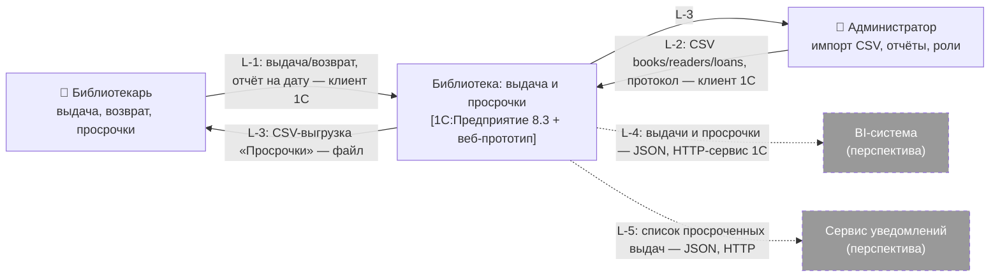

# C4 Context — Кейс 8 «Библиотека: выдача и просрочки»

ПР 3–4, занятие 4. Содержание диаграммы от тимлида; отрисовка в draw.io — фулстек (Блох Максим) → `c4-context.drawio` + `c4-context.png` в `/docs/hack1`.

| Поле | Значение |
|---|---|
| Версия | v1.1 (уточнена технология системы и подпись L-1) |
| Дата | 31.10.2026 |
| Автор содержания | Баринин Тимофей (тимлид) |
| Подписи связей с данными | Никитин Даниил (1С), вклад 1С §4.1, исправлен по [review-1c.md](review-1c.md) |
| Проверка на соответствие Use Case | ☐ Ермаков Артём (аналитик) |

## 1. Элементы диаграммы

### Persons (первичные акторы из Use Case)

| Элемент | Описание на диаграмме | Use Case |
|---|---|---|
| **Библиотекарь** | Сотрудник библиотеки. Оформляет выдачу и возврат, контролирует просрочки | UC-08-1, UC-08-2, UC-08-4, UC-08-5 |
| **Администратор** | Загружает данные из CSV, выгружает отчёты, ведёт роли и журнал | UC-08-3, UC-08-4, UC-08-5 |

### Наша система (один прямоугольник, без внутренних деталей)

| Элемент | Описание на диаграмме |
|---|---|
| **«Библиотека: выдача и просрочки»** | Учёт выдач и возвратов, статусы выдач, отчёт «Просрочки» на дату, импорт и экспорт CSV. [1С:Предприятие 8.3 + веб-прототип] |

### Внешние системы (вторичные акторы, в перспективе)

| Элемент | Описание на диаграмме | Статус |
|---|---|---|
| **BI-система** (например, 1С:Аналитика) | Визуализация показателей просрочек и оборачиваемости фонда | Перспектива — пунктир |
| **Сервис уведомлений** | Напоминания читателям о сроке возврата и просрочке | Перспектива — пунктир |

## 2. Связи (каждая подписана: «что + как»)

| № | От → к | Подпись связи | Линия |
|---|---|---|---|
| L-1 | Библиотекарь → Система | «Оформляет выдачу и возврат (`reader_id`, `book_code`, даты); формирует отчёт „Просрочки“ на дату — через клиент 1С (в демо — также веб-прототип)» | Сплошная |
| L-2 | Администратор → Система | «Загружает CSV books / readers / loans (UTF-8), получает протокол импорта — через клиент 1С» | Сплошная |
| L-3 | Система → Библиотекарь, Администратор | «Отдаёт CSV-выгрузку отчёта „Просрочки“ (`reader_id, book_code, days_overdue` и др., формат golden) — файл CSV» | Сплошная |
| L-4 | Система → BI-система | «Передаёт данные о выдачах и просрочках на дату — JSON по HTTP-сервису 1С (GET /overdue?date=)» | Пунктир (перспектива) |
| L-5 | Система → Сервис уведомлений | «Передаёт список просроченных выдач (читатель, книга, срок, дней просрочки) — JSON по HTTP» | Пунктир (перспектива) |

## 3. Чего на диаграмме нет и почему

| Не рисуем | Почему |
|---|---|
| АБИС (ИРБИС, «1С:Библиотека») | Интеграции нет — это граница OUT-3 в [vision.md](vision.md#5-границы-системы). CSV приносит администратор, это подписано на L-2 |
| Веб-прототип, мок-REST, регистры, отчёт СКД | Это внутренние части нашей системы (их разрабатывает команда), уровень C4 Container / Component — ПР 5–6. Поэтому в технологии прямоугольника системы указано «1С:Предприятие 8.3 + веб-прототип», а не только 1С |
| Читатель | Роль Could, в MVP у него нет Use Case (решение D-5). Когда появится экран «Мои выдачи», добавим как person с пунктиром |

## 4. ТЗ на отрисовку (для фулстека)

1. Draw.io, нотация C4 Context: persons — фигура человека; наша система — один прямоугольник в центре (синий); внешние системы — прямоугольники **серого** цвета.
2. В каждом элементе — название жирным и одна строка описания из §1.
3. Связи L-1…L-5 — стрелки с подписями из §2 дословно. Перспективные связи (L-4, L-5) и рамки перспективных систем — **пунктиром**.
4. Легенда в углу: «сплошная — MVP, пунктир — перспектива; серый — внешняя система».
5. Заголовок: «C4 Context — Кейс 8 „Библиотека: выдача и просрочки“, v1.1, 31.10.2026».
6. Сохранить `c4-context.drawio` и экспорт `c4-context.png` в `/docs/hack1`.

Набросок для сверки:

## 5. Проверка по чек-листу ПР 3–4 (4 пункта)

| № | Вопрос чек-листа | Ответ |
|---|---|---|
| 1 | Каждый первичный актор из Use Case показан на диаграмме отдельным элементом? | ✓ Библиотекарь, Администратор |
| 2 | Каждая внешняя система, упомянутая в сценариях, нарисована снаружи границы? | ✓ BI-система, сервис уведомлений. АБИС в сценариях не участвует (OUT-3) |
| 3 | У каждой связи подписано, что передаётся (а не только направление)? | ✓ L-1…L-5: что + как |
| 4 | Внутри границы — только один прямоугольник нашей системы, без внутренних деталей? | ✓ Веб, мок, регистры вынесены на уровень Container (ПР 5–6) |

## 6. Соответствие Use Case (для проверки аналитиком)

| Актор / система из UC | Тип | На C4 Context |
|---|---|---|
| Библиотекарь | Первичный | Person ✓ |
| Администратор | Первичный | Person ✓ |
| BI-система | Вторичный (перспектива) | Внешняя система, пунктир ✓ |
| Сервис уведомлений | Вторичный (перспектива) | Внешняя система, пунктир ✓ |
| Читатель | Could, решение D-5 | Не показан (нет UC в MVP) |
